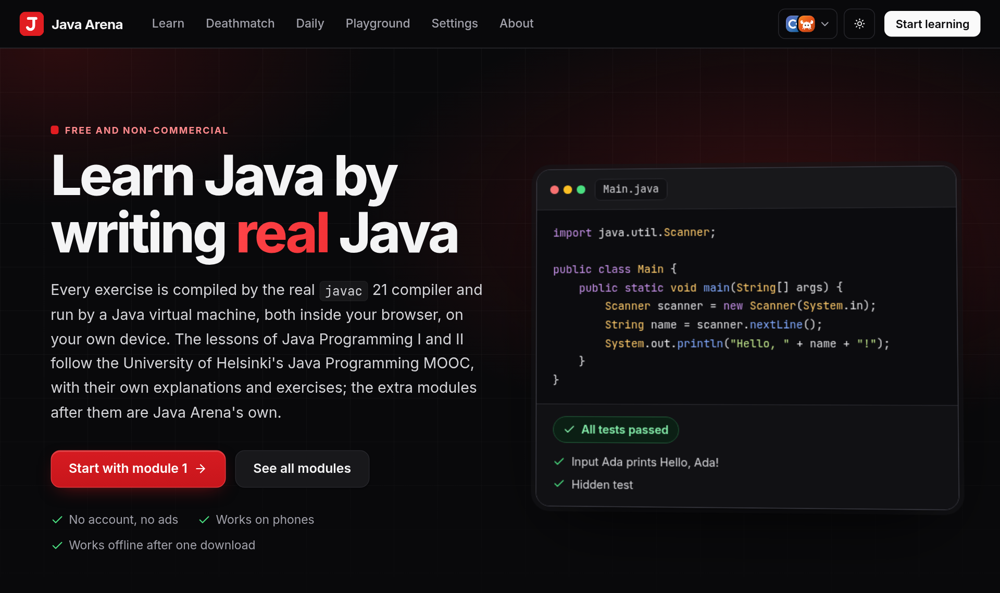
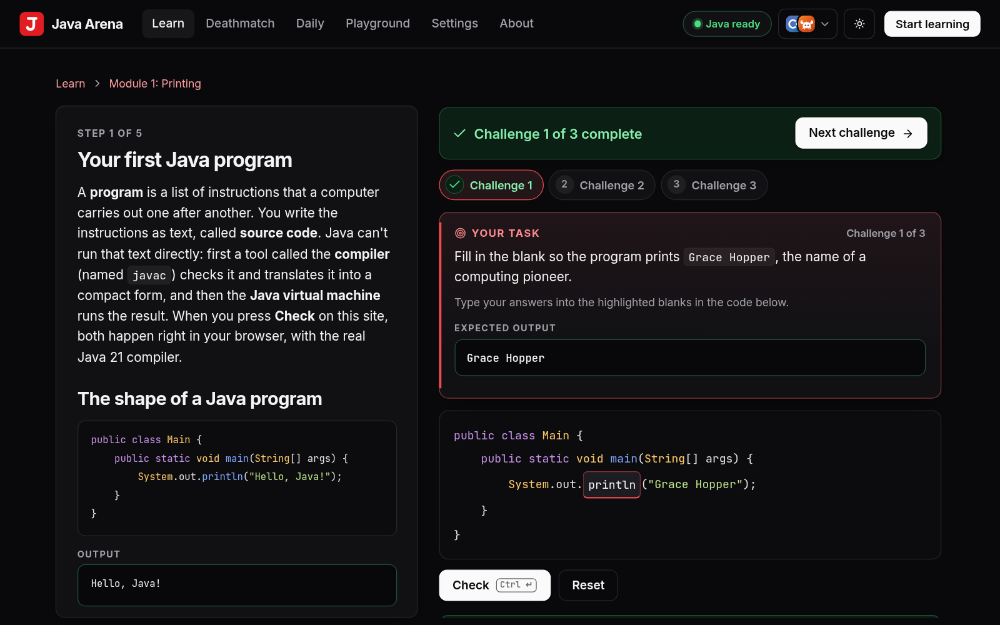
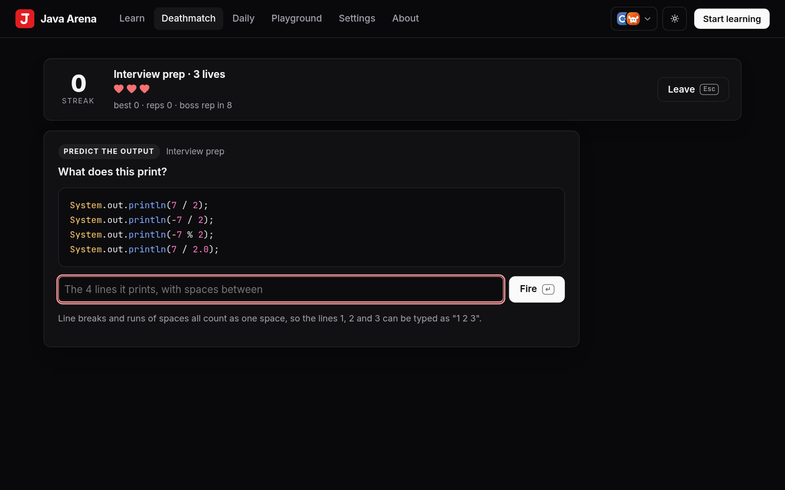
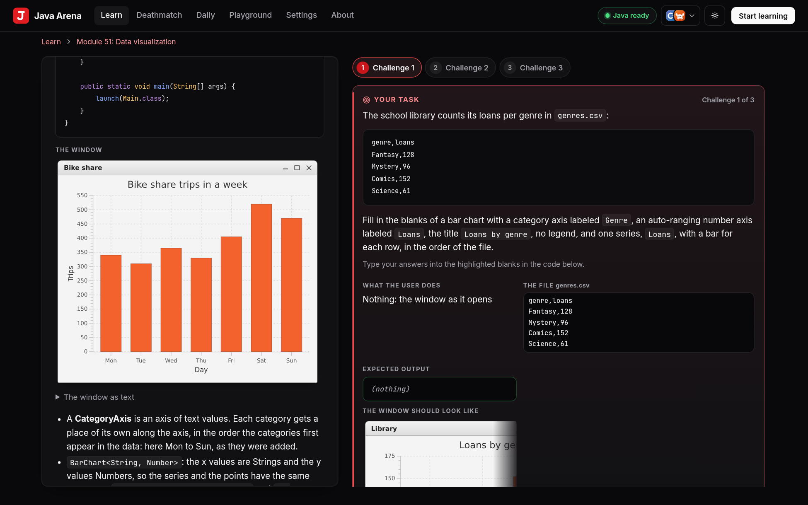
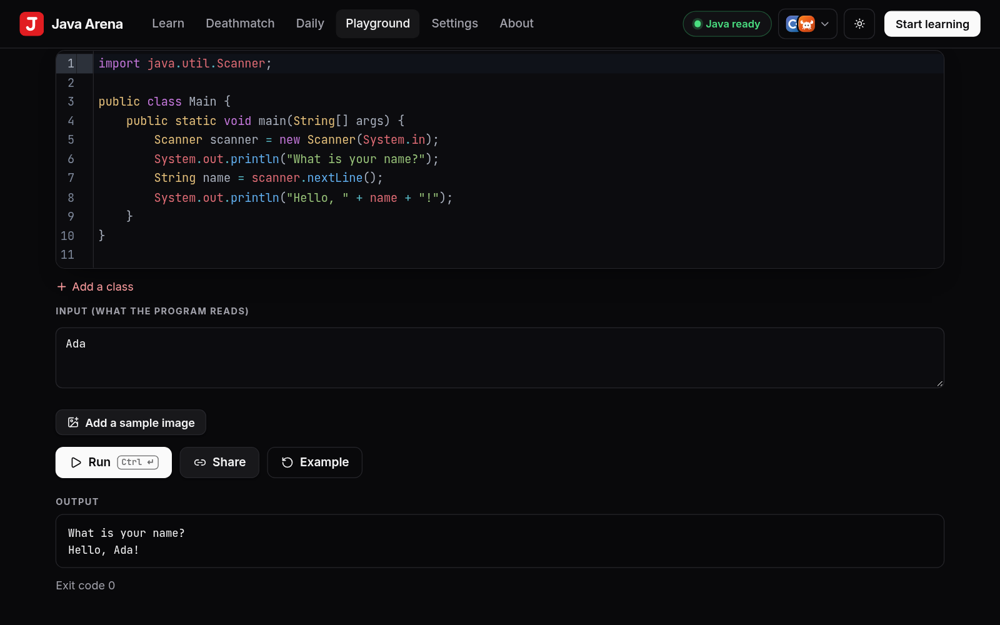
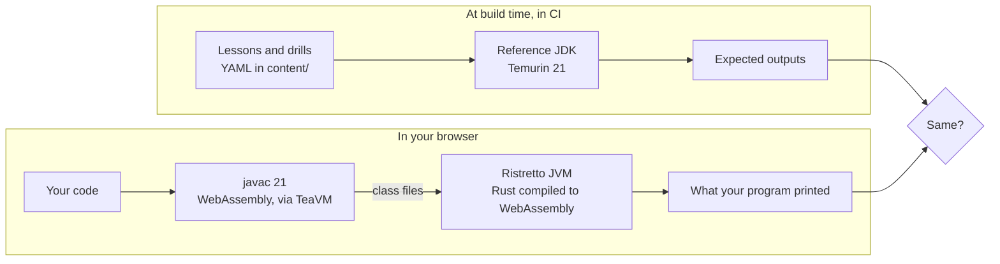

<div align="center">

<a href="https://javaarena.com"></a>

# Java Arena

**Learn Java by writing real Java.**

The real `javac` 21 compiler and a Java virtual machine, compiled to WebAssembly and running in your browser.<br>
No backend, no account, no ads. Free and non-commercial.

[**Start learning**](https://javaarena.com) &nbsp;·&nbsp; [Course plan](https://javaarena.com/learn/) &nbsp;·&nbsp; [Playground](https://javaarena.com/playground/) &nbsp;·&nbsp; [How it works](#how-it-works) &nbsp;·&nbsp; [Run it locally](#quick-start)

[](https://javaarena.com)
[](https://openjdk.org/projects/jdk/21/)
[](#how-it-works)
[](https://react.dev)
[](https://www.typescriptlang.org)
[](https://vite.dev)
[](LICENSE)
[](content/LICENSE)

<a href="https://javaarena.com">
  <picture>
    <source media="(prefers-color-scheme: dark)" srcset="docs/images/hero-dark.png">
    <source media="(prefers-color-scheme: light)" srcset="docs/images/hero-light.png">
    
  </picture>
</a>

| 59 | 359 | 1,077 | 930 | 4 | 3 | 247 |
|:---:|:---:|:---:|:---:|:---:|:---:|:---:|
| modules | steps | challenges | Deathmatch drills | guided projects | Pro Track projects | reference topics |

</div>

## Why Java Arena

- **A real compiler, not a look-alike.** Your code goes through OpenJDK's `javac` 21 and runs on a JVM with the real OpenJDK 21 class library, so it accepts exactly the APIs a real JDK 21 has.
- **Everything happens on your device.** The site is static: your code is compiled and run in the browser, not on a server. It works offline after the first visit and installs as an app.
- **Every answer is checked against a real JDK.** The build compiles and runs every solution, example and drill on the reference JDK, and CI replays every lesson program in the browser engine and fails on any difference.
- **Written for beginners, and for phones.** Compile errors and crashes come with plain-English explanations, hints unlock one at a time, and every page type is tested from 320 px wide against WCAG 2.2 AA.

The course follows the order and topics of the University of Helsinki's [Java Programming MOOC](https://java-programming.mooc.fi) (parts 1 to 14), with its own lessons and exercises, then adds five extra modules on recursion, newer Java features and linked data structures.

## What's inside

| Feature | What you get |
|---|---|
| **Course** | 59 modules and 359 steps. Each step is a short lesson with three challenges: fill in the blanks, fix a program, write one, or predict what a program prints. Graded by input and output tests (some hidden), by tests that call your methods, and by rules about the code. |
| **Deathmatch** | 930 quick drills that unlock as you finish lesson steps: predict the output, fill the blank, spot the bug, will it compile, pick one, and a "boss rep" program to write every 8th rep. Four modes: one life, three lives, spaced review, and interview prep. |
| **Daily challenge and placement quiz** | The same drill for everyone on a given date, and a quiz that lets you skip the modules you already know. |
| **Projects** | Four larger programs built over six milestones each: a text adventure, a loan desk, the Game of Life and a calculator. Each milestone starts from your own code that passed the one before. |
| **Pro Track** | Three projects for your own computer with JDK 21, Maven and JUnit 5: a word statistics tool, a database app with JDBC and H2, and a JavaFX memory game. A GitHub Actions workflow runs the tests in your own repository. See [`pro-track/`](pro-track/README.md). |
| **Playground** | Write and run any program with your own input, in one file or several, and share it as a link that carries the code. |
| **GUI lessons** | Windows, events, charts, a canvas and an Asteroids game, written as ordinary JavaFX code. The page draws your window and runs your program again for each click, using Java Arena's own practice version of JavaFX, which CI checks against real OpenJFX 21. |
| **Unit testing** | JUnit 4 runs in the browser. Your tests must pass on the correct class and catch the versions with bugs. |
| **Topics A to Z** | 247 Java keywords, classes, methods and ideas, each with a one-line description and links to the steps that teach it. Searchable, also offline. |
| **Your progress** | Saved in the browser. Move it to another device with a link, a QR code or a file, and print a personal record of what you finished. |

Every feature is described in detail in [`docs/architecture.md`](docs/architecture.md).

## Screenshots

<table>
  <tr>
    <td width="50%" valign="top">
      <a href="docs/images/lesson.png"></a>
      <br><sub><b>Lessons.</b> A short lesson and three challenges per step, compiled and run on your device.</sub>
    </td>
    <td width="50%" valign="top">
      <a href="docs/images/deathmatch.png"></a>
      <br><sub><b>Deathmatch.</b> Endless quick drills with lives, streaks and boss reps.</sub>
    </td>
  </tr>
  <tr>
    <td width="50%" valign="top">
      <a href="docs/images/javafx.png"></a>
      <br><sub><b>GUI lessons.</b> The page draws the windows and charts your JavaFX code opens.</sub>
    </td>
    <td width="50%" valign="top">
      <a href="docs/images/playground.png"></a>
      <br><sub><b>Playground.</b> Run any program with your own input and share it as a link.</sub>
    </td>
  </tr>
</table>

## How it works



- **Compiler.** OpenJDK's `javac` 21, compiled to WebAssembly (Wasm GC) with [teavm-javac](https://github.com/konsoletyper/teavm-javac) and [TeaVM](https://github.com/konsoletyper/teavm). See [`engine/compiler/`](engine/compiler/).
- **Runner.** A fork of [Ristretto](https://github.com/theseus-rs/ristretto), a JVM written in Rust and compiled to WebAssembly, running the real OpenJDK 21 class library. See [`engine/runner/`](engine/runner/).
- **In the page.** A compile worker that stays alive and a fresh run worker per run, which is killed when a test goes over the time limit, so an endless loop can't freeze the page. Engine files download once and are kept in Cache Storage. See [`src/engine/`](src/engine/).
- **Libraries.** JUnit 4.13.2 and the practice version of JavaFX are downloaded the first time a program uses them. See [`engine/libraries/`](engine/libraries/).
- **Fidelity.** [`fidelity/`](fidelity/) holds 52 programs and 92 compile errors. CI runs them on the JDK and in the browser engine and fails on any difference.

| Measure | Result |
|---|---|
| Engine download | about 15.2 MB compressed, once, then cached |
| Warm compile | about 10 to 90 ms |
| Hello World | about 0.4 s from click to output |

<sub>Measured in headless Chromium on a 4-core machine when the engine was built. [`docs/architecture.md`](docs/architecture.md#how-the-engine-works) has the full write-up, with measurements on a phone.</sub>

## Curriculum

<details>
<summary><b>59 modules</b>: the 14 parts of Java Programming I and II, then five extra modules</summary>

<br>

| Part | Modules | Topics |
|:---:|:---:|---|
| 1 | 1 to 6 | Printing, reading input, variables and types, calculating, making decisions, conditions and logic |
| 2 | 7 to 11 | Problem-solving patterns, `while` and `for` loops, methods and parameters, return values and the call stack |
| 3 | 12 to 16 | Finding bugs, lists, for-each and list methods, arrays, strings |
| 4 | 17 to 20 | Classes and objects, getters and `toString`, objects in a list, reading files |
| 5 | 21 to 23 | Designing classes and overloading, primitive and reference variables, objects working together |
| 6 | 24 to 26 | Lists inside objects, separating the UI from program logic, troubleshooting and unit testing |
| 7 | 27 to 29 | Procedural and object-oriented programs, sorting and searching, larger programs |
| 8 | 30 to 33 | Recap of parts 1 to 7, hash maps, `equals` and `hashCode`, grouping data |
| 9 | 34 to 36 | Inheritance and abstract classes, interfaces, polymorphism |
| 10 | 37 to 39 | Streams and lambdas, `Comparable` and `Comparator`, `StringBuilder`, regular expressions, enums and iterators |
| 11 | 40 to 43 | Class diagrams, packages and imports, exceptions, writing files |
| 12 | 44 to 47 | Generics, building your own list and hash map, random numbers, two-dimensional arrays |
| 13 | 48 to 50 | GUI: windows, components and layouts, event handling, multiple views |
| 14 | 51 to 54 | Data visualization, drawing and images, an Asteroids-style game, libraries, Maven and databases |
| Extra | 55 to 59 | Recursion, records, `switch` with `var` and text blocks, pattern matching and sealed types, linked lists, stacks, queues and trees |

Parts 1 to 7 are Java Programming I and parts 8 to 14 are Java Programming II. The extra modules are Java Arena's own and are marked "Extra" on the site. The full map, with the MOOC section each step covers, is in [`docs/research/curriculum-map.md`](docs/research/curriculum-map.md).

</details>

## Quick start

Needs Node 22.18 or newer. The reference JDK (Eclipse Temurin 21.0.10+7) is fetched by `scripts/get-jdk.sh` the first time a script needs it; set `JAVA_HOME` to use another JDK 21.

```bash
git clone https://github.com/AntonyPerez0/Java-Arena.git
cd Java-Arena
npm install        # also copies the built engine into public/engine
npm run dev        # checks the lessons, then serves http://localhost:5173/
```

| Script | What it does |
|---|---|
| `npm run dev` | Checks the lessons on the reference JDK, then starts the dev server |
| `npm run build` | Checks the lessons, type-checks and builds `dist/` (pre-rendered pages, service worker, sitemap) |
| `npm run test:unit` | Unit tests that need no browser |
| `npm run test:e2e` | Browser tests of the built site, including accessibility and the phone pass |
| `npm run fidelity` | Runs the fidelity suite on the JDK and in the browser engine and compares |
| `npm run content:browser` | Replays every lesson program in the browser engine and compares with the JDK |
| `npm run fx-check` | Runs every JavaFX program on real OpenJFX 21 and on Java Arena's JavaFX and compares |
| `npm run pro-track-check` | Checks that each Pro Track starter fails its tests and each model solution passes |
| `npm run check-links` | Checks every internal and external link in the built site |

All scripts, and what each CI job does, are in [`docs/development.md`](docs/development.md). Rebuilding the engine itself is only needed when changing it: see [`engine/compiler/README.md`](engine/compiler/README.md) and [`engine/runner/README.md`](engine/runner/README.md).

## Quality gates

[`deploy.yml`](.github/workflows/deploy.yml) builds and tests every pull request, and publishes to GitHub Pages when one merges into `main`. The site is published only after the build and every check job pass:

- **Content build**: every solution, example and drill compiles and runs on the reference JDK.
- **Content replay**: every lesson program runs again in the browser engine and must match the JDK.
- **Fidelity**: the 52 programs and 92 compile errors behave the same on the JDK and in the browser.
- **Real JavaFX**: every GUI program gives the same output and window on OpenJFX 21 and on Java Arena's JavaFX.
- **Browser tests**: lessons, the engine, offline use, moving progress, projects and the Pro Track pages.
- **Phone pass**: every page type at 320, 360, 390 and 412 px in both themes, with axe (WCAG 2.2 AA).
- **Pro Track**: each starter fails its tests and each model solution passes them, with real Maven.
- **Link check**: every internal link resolves and every external link goes to an allowed host. Pull requests also get Lighthouse scores.

## Project layout

```
content/              Lessons, drills, projects and topics (YAML, CC BY-NC-SA 4.0)
engine/               The Java engine: compiler, runner, libraries and their built files
fidelity/             Programs and compile errors that must match JDK 21
pro-track/            The Pro Track's starter projects (Maven, JUnit 5)
pro-track-solutions/  Their model solutions, used by CI
scripts/              Content build, pre-rendering, checks and tests
src/                  The site (React, TypeScript): pages, editor, grader, engine workers
docs/                 Architecture, development notes and the research behind the plan
```

## Documentation

| Document | What's in it |
|---|---|
| [Architecture](docs/architecture.md) | Every feature of the site and how the engine works, in detail |
| [Development](docs/development.md) | Running locally, every script, CI jobs and deploying your own copy |
| [Writing lessons](content/README.md) | The YAML format of modules, drills, projects and topics, and how they are checked |
| [The Pro Track](pro-track/README.md) | The projects for your own computer, and the rules a project folder follows |
| [Research notes](docs/research/README.md) | The curriculum map and the comparison of ways to run Java in a browser |
| [Build history](docs/history.md) | The 20 batches the site was built in, one pull request each |
| [Third-party notices](THIRD_PARTY_NOTICES.md) | Licenses of the engine's parts and the site's libraries |

## The Arena sites

Java Arena is one of four sites that teach a language the same way, free.

| Site | Teaches | Source |
|---|---|---|
| [C/C++ Arena](https://cpparena.com) | C and C++ | [cpp-arena](https://github.com/AntonyPerez0/cpp-arena) |
| **[Java Arena](https://javaarena.com)** | Java | this repository |
| [RustArena](https://rustarena.app) | Rust | [RustArena](https://github.com/AntonyPerez0/RustArena) |
| [Python Arena](https://pythonarena.org) | Python | [pythonarena](https://github.com/AntonyPerez0/pythonarena) |

## Feedback

Found a mistake in a lesson, or a program that behaves differently than on a real JDK? Every challenge on the site has a "Report a problem" link that opens an issue with your code filled in, or you can [open an issue](https://github.com/AntonyPerez0/Java-Arena/issues/new) here.

## License and credits

- **Site code**, and the Pro Track's projects in `pro-track/`: MIT. See [LICENSE](LICENSE) for what it covers.
- **Lesson content** in `content/`: [CC BY-NC-SA 4.0](content/LICENSE), as it follows the CC BY-NC-SA 4.0 licensed MOOC. See [content/README.md](content/README.md).
- **Third-party components** keep their own licenses. See [THIRD_PARTY_NOTICES.md](THIRD_PARTY_NOTICES.md), and [engine/SOURCES.md](engine/SOURCES.md) for the source offer for the GPL parts.

The course follows the order and topics of [Java Programming](https://java-programming.mooc.fi) by Arto Hellas, Matti Luukkainen and contributors (Agile Education Research group, University of Helsinki). The explanations, examples, exercises, hints and solutions are written for Java Arena. The engine stands on [OpenJDK](https://openjdk.org), [TeaVM](https://github.com/konsoletyper/teavm), [teavm-javac](https://github.com/konsoletyper/teavm-javac) and [Ristretto](https://github.com/theseus-rs/ristretto), and the site's design is adapted from [C/C++ Arena](https://cpparena.com).

Java Arena was built with AI assistance (Claude); every solution, example and drill is compiled and run on a real JDK before the site is published.

Java Arena is not affiliated with or endorsed by the University of Helsinki, MOOC.fi or Oracle. Java is a registered trademark and JavaFX a trademark of Oracle and/or its affiliates.
